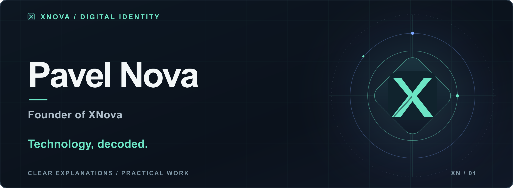

  

<h1 align="center">Pavel Nova</h1>

<strong>Founder of XNova</strong> · Technology, decoded.

## About XNova

XNova is an independent technology brand creating technical articles, courses, and reproducible projects across disciplines.

We pair clear explanations with practical examples, show the reasoning behind engineering choices, and make results possible to check.

## Explore XNova

| Destination | Where it leads |
| :-- | :-- |
| **01 / Website** | <a href="https://xnova.dev/">Explore XNova</a> · The brand and its approach |
| **02 / Articles** | <a href="https://xnova.dev/articles/">Read articles</a> · Technical explanations |
| **03 / Courses** | <a href="https://xnova.dev/courses/">Browse courses</a> · Structured learning |
| **04 / Projects** | <a href="https://xnova.dev/projects/">See projects</a> · Reproducible practice |
| **05 / Contact** | <a href="https://xnova.dev/contacts/">Get in touch</a> · Questions and collaboration |

## Connect

For questions or collaboration, <a href="https://xnova.dev/contacts/">contact XNova</a>.

- <a href="https://github.com/xnova-tech">XNova on GitHub</a>
- <a href="https://medium.com/@xnova.dev">XNova on Medium</a>
- <a href="https://www.linkedin.com/in/pavel-nova-3abb62444/">Pavel Nova on LinkedIn</a>

